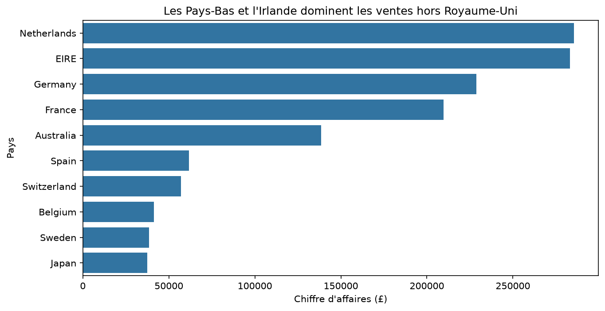
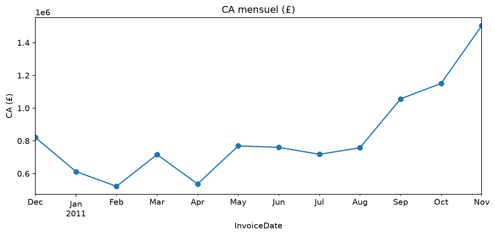
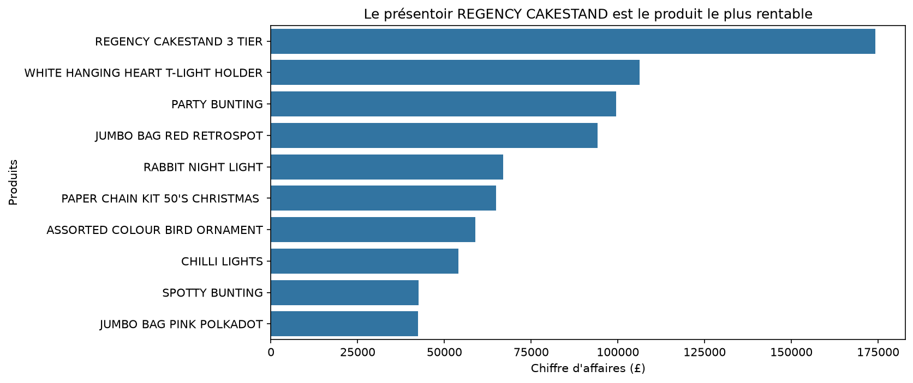

# projet-analyse
# Analyse des ventes d'un e-commerçant britannique (2010-2011)

Projet réalisé par Ali et Andy — module « Python pour l'analyse de données » (HETIC).

## Questions étudiées
1. Quels pays, hors Royaume-Uni, rapportent le plus de chiffre d'affaires, et quel continent domine ?
2. Comment le chiffre d'affaires évolue-t-il mois par mois ? Y a-t-il un pic avant Noël ?
3. Quels jours de la semaine et quelles heures concentrent le plus de commandes ?
4. Quels produits rapportent le plus de chiffre d'affaires ?

## Données
- **Source :** [Online Retail sur Kaggle](https://www.kaggle.com/datasets/carrie1/ecommerce-data), données d'origine du UCI Machine Learning Repository
- **Licence (source d'origine) :** CC BY 4.0
- **Téléchargées le :** 22/10/2026
- **Contenu :** 541 909 lignes (une ligne = un produit dans une facture), du 01/12/2010 au 09/12/2011
- **Fichier brut :** `data/raw/online_retail.csv` (jamais modifié)
- **Fichier propre :** `data/processed/online_retail_propre.csv` (524 876 lignes, produit par `02_nettoyage`)

## Installation
```bash
git clone https://github.com/Ali77225/projet-analyse.git
cd projet-analyse
python -m venv .venv
.venv\Scripts\activate          # Windows
source .venv/bin/activate       # macOS / Linux
pip install -r requirements.txt
```

## Ordre d'exécution
1. `notebooks/01_exploration.ipynb` : chargement typé et constats
2. `notebooks/02_nettoyage.ipynb` : nettoyage justifié, crée le fichier propre
3. `notebooks/03_analyse.ipynb` : CA par pays (Q1) et top produits (Q4)
4. `notebooks/04_jointure_temps.ipynb` : jointure pays → continent (Q1), analyse dans le temps (Q2, Q3)

## Structure du dépôt
```
projet-analyse/
├── data/
│   ├── raw/          # données d'origine
│   └── processed/    # données nettoyées
├── figures/          # graphiques enregistrés
├── notebooks/        # analyses, dans l'ordre d'exécution
├── src/              # fonction de chargement réutilisée
├── requirements.txt
└── README.md
```

## Nettoyage
17 033 lignes supprimées (541 909 → 524 876) : doublons (5 268), descriptions vides (1 454), quantités ≤ 0 dont les annulations (9 725), prix ≤ 0 (584), 2 commandes géantes annulées juste après. Les clients non identifiés sont gardés (« Inconnu »). Détail et justifications dans `02_nettoyage`.

## Principaux résultats
Chiffre d'affaires total après nettoyage : ≈ 10,40 M£, dont 84 % au Royaume-Uni.

**Q1 — Pays et continents.** Hors Royaume-Uni, les Pays-Bas (≈ 285 k£) et l'Irlande (≈ 283 k£) arrivent en tête, devant l'Allemagne et la France. L'Europe domine largement avec 85 % du CA hors Royaume-Uni ; l'Océanie (Australie seule) est deuxième avec 8 %.



**Q2 — Évolution mensuelle.** Oui, il y a un pic avant Noël : le CA grimpe dès septembre (≈ 1,06 M£) et culmine en novembre 2011 (≈ 1,50 M£), plus du double d'un mois de début d'année.



**Q3 — Jours et heures.** Le jeudi concentre le plus de commandes (4 246), le dimanche le moins (2 204) ; aucune commande le samedi. Les commandes se font surtout entre 10 h et 15 h, avec un pic à midi (3 220).

**Q4 — Produits.** Le présentoir REGENCY CAKESTAND 3 TIER est de loin le produit le plus rentable (≈ 174 k£), devant WHITE HANGING HEART T-LIGHT HOLDER (≈ 106 k£) et PARTY BUNTING (≈ 99 k£). Les frais (port, banque, Amazon…) ont été exclus de ce classement.



## Limites
- Une seule entreprise, sur à peine plus d'un an : on ne peut pas généraliser ni comparer deux années.
- Décembre 2011 est incomplet (données arrêtées le 9) : exclu de la courbe mensuelle.
- Le Royaume-Uni pèse 84 % du CA : les autres pays reposent sur beaucoup moins de ventes.
- 25 % des ventes n'ont pas d'identifiant client : aucune analyse par client n'est possible.
- Le CA est calculé comme quantité × prix, sans les remises ni les retours.